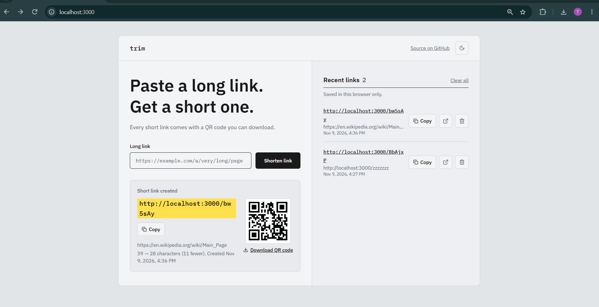
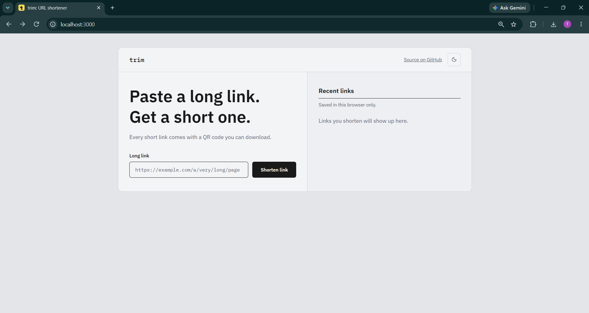
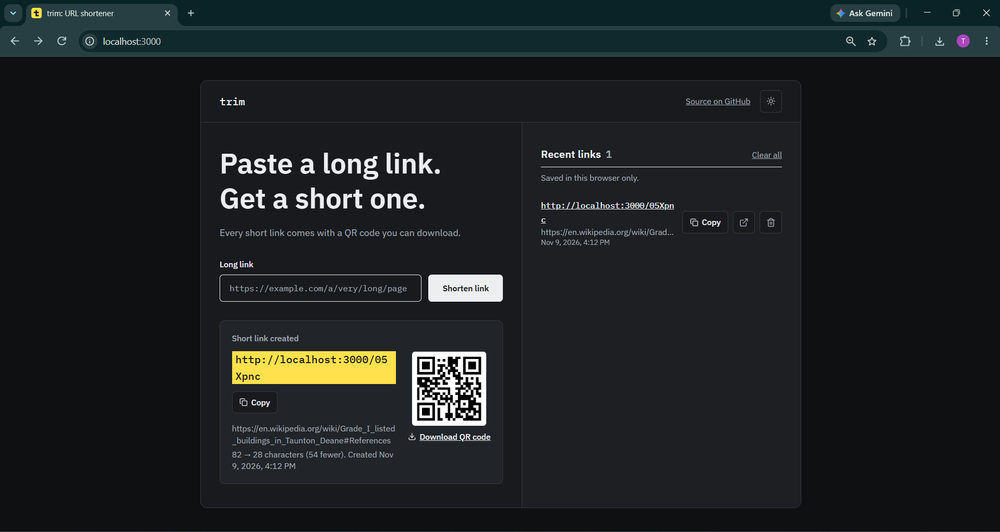
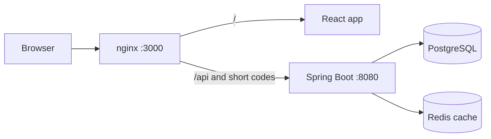

# trim

A full-stack URL shortener. Paste a long link, get a short one, copy it or scan its QR code. The whole stack (frontend, backend, database, cache) starts with one command.

<!-- Live demo: uncomment and fill in once it is deployed -->
<!-- **Live demo:** https://your-app-address-here -->

<p align="center">
  
</p>

<p align="center">
  
  
</p>


## Quick start

You need [Docker Desktop](https://www.docker.com/products/docker-desktop/) (or Docker Engine with the Compose plugin) running. Nothing else: no Java or Node install.

```bash
git clone https://github.com/tejas-j20/url-shortener.git
cd url-shortener
docker compose up --build
```

Open **http://localhost:3000**. The first build takes a few minutes while dependencies download.

Stop with `Ctrl+C`, or `docker compose down`. Links are kept in a Docker volume; `docker compose down -v` deletes them.

## Features

- Shorten any http/https link to a 6-character code
- Short links redirect (HTTP 302) to the original URL
- Unique codes: a collision check with retry, plus a unique database constraint
- URL validation on both the frontend and the backend (only http and https are accepted)
- Redis cache for redirects, with a one-hour expiry
- QR code for every short link, with download
- Recent links list (stored in your browser only), copy button, filter
- Light and dark mode, responsive layout, keyboard-friendly
- A friendly 404 page for short links and paths that do not exist

## How it works



nginx serves the React build and forwards API calls and short-link requests to Spring Boot, so the browser only talks to one address and needs no CORS workarounds in production. On a redirect, Spring Boot checks Redis first and falls back to PostgreSQL on a miss.

## API

| Method | Path | Description |
|---|---|---|
| `POST` | `/api/v1/shorten` | Create a short link. Returns `400` for an invalid URL |
| `GET` | `/{shortLink}` | Redirect to the original URL (`302`), or `404` if unknown |

Request:

```json
POST /api/v1/shorten
{ "originalUrl": "https://en.wikipedia.org/wiki/Docker_(software)" }
```

Response:

```json
{
  "originalUrl": "https://en.wikipedia.org/wiki/Docker_(software)",
  "shortLink": "aB3xY9",
  "fullShortUrl": "http://localhost:3000/aB3xY9",
  "createdAt": "2026-11-09T08:33:12Z"
}
```

## Tech stack

| Layer | Technology |
|---|---|
| Frontend | React, Vite, Tailwind CSS, served by nginx |
| Backend | Java 21, Spring Boot, Spring Data JPA |
| Database | PostgreSQL |
| Cache | Redis |
| DevOps | Docker, Docker Compose, multi-stage builds |

## Design notes

- **Redis caching, measured.** I counted database queries for 500 redirects to the same link: about 468 without the cache, 1 with it. Response time stayed around 3 ms either way, because my table is tiny and indexed. The benefit is less load on the database, which matters at larger scale.
- **Timestamps are stored and sent in UTC** (with a `Z` suffix), and the browser converts them to local time. Docker containers run in UTC, so sending a bare local time showed the wrong time.
- **Containers talk by service name** (`db`, `redis`, `backend`), not `localhost`. Settings come from environment variables, so the same image runs anywhere.
- **Unknown links keep their 404 status.** nginx swaps in a styled page (`error_page`) instead of redirecting, so the address stays the same and clients still receive a real 404.
- **QR codes come from api.qrserver.com**, so the short URL is sent to that service. Generating them locally is a possible improvement.

## Configuration

Set in `docker-compose.yml`:

| Variable | Default in Compose | Purpose |
|---|---|---|
| `SPRING_DATASOURCE_URL` | `jdbc:postgresql://db:5432/urlshortener` | Database address |
| `SPRING_DATASOURCE_USERNAME` / `PASSWORD` | `postgres` / `root` | Database login (local demo values) |
| `SPRING_DATA_REDIS_HOST` | `redis` | Redis address |
| `APP_BASE_URL` | `http://localhost:3000` | Base address used in generated short links |

The database password is a local demo value. Do not reuse it in a public deployment. If you deploy, set `APP_BASE_URL` to your real address.

## Development without Docker for the app

Run only the database and Redis in Docker (publish ports `5432` and `6379` for the `db` and `redis` services in `docker-compose.yml` first):

```bash
docker compose up -d db redis
```

Run the backend from your IDE (port 8080), then the frontend:

```bash
cd frontend
npm install
npm run dev
```

Open http://localhost:5173.

Run the unit tests:

```bash
cd backend
./mvnw -Dtest=UrlServiceTest test     # Windows: .\mvnw
```

## Project structure

```
url-shortener/
├── backend/               Spring Boot app (controller, service, repository, model, dto)
├── frontend/              React + Vite app, nginx config, Dockerfile
├── docs/                  Screenshots and demo GIF used in this README
├── docker-compose.yml     Runs frontend, backend, PostgreSQL and Redis
└── README.md
```

## Troubleshooting

- **Port 3000 already in use:** change `"3000:80"` in `docker-compose.yml` and set `APP_BASE_URL` to the same port.
- **"Cannot connect to the Docker daemon":** start Docker Desktop and wait for "Engine running".
- **Code changes do not show up:** rebuild with `docker compose up -d --build`.

## Roadmap

- [ ] Click counts per link
- [ ] Custom aliases and expiry dates
- [ ] Integration tests and CI

## License

MIT. See [LICENSE](LICENSE).

## Author

Built by Tejas Jagannath ([@tejas-j20](https://github.com/tejas-j20)) as a learning project.
